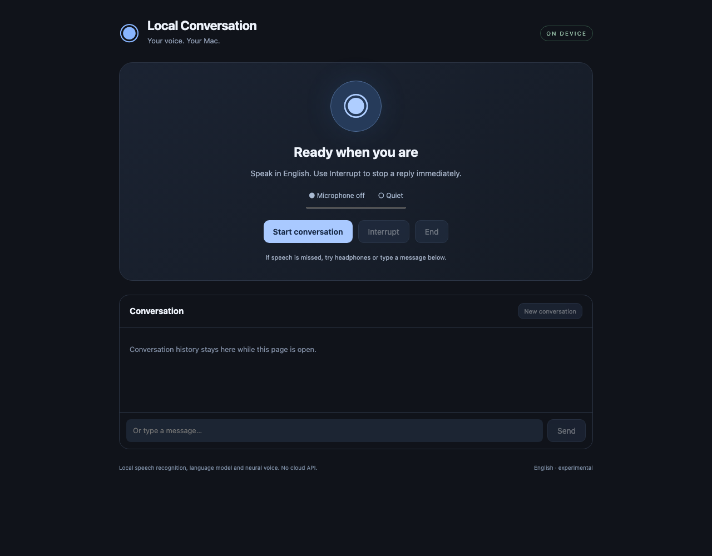
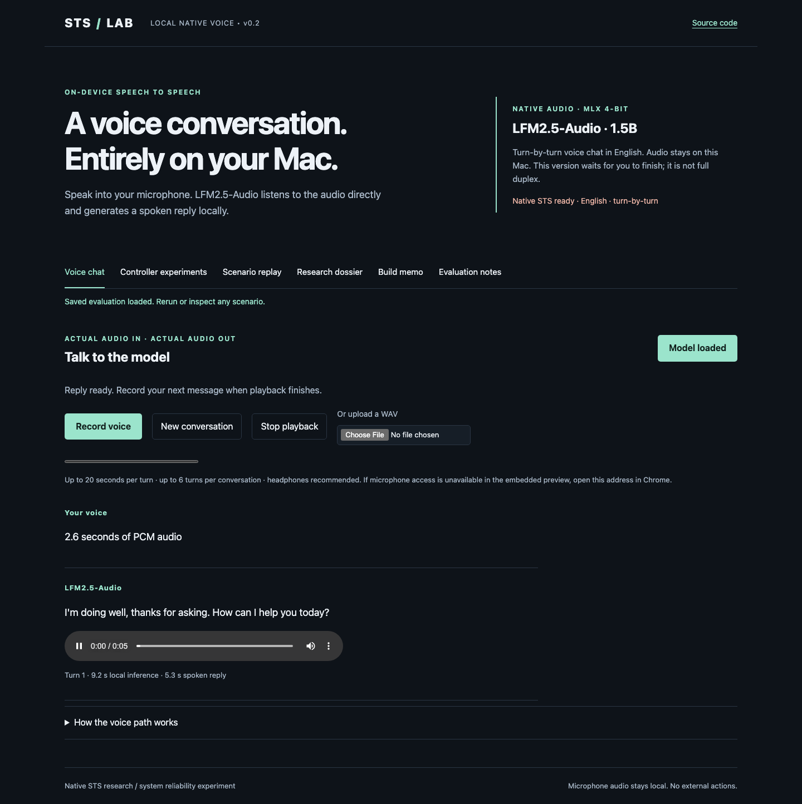

<div align="center">

# Local Speech Lab

**Native speech-to-speech and interruptible voice conversations on Apple Silicon.**

[](LICENSE) [](pyproject.toml) [](#requirements)

[Quick start](#quick-start) · [Architecture](#architecture) · [Evaluation](#evaluation) · [Development](CONTRIBUTING.md)

</div>

Local Speech Lab explores a practical question: **how much conversational voice AI can an 8 GB Mac run locally?** It includes a native audio model for turn-based voice chat, a streaming cascade with interruption handling, and reproducible experiments that distinguish model quality from audio-system reliability.

Model inference stays on the Mac. Model weights are downloaded separately; no paid inference API is required.



<sub>Actual local interface at startup. The screenshot does not open the microphone or simulate a conversation.</sub>

## Two ways to run

### Native voice chat — turn-based

The most established voice path uses **LFM2.5-Audio-1.5B, MLX 4-bit**. Record a question, submit it, and play the generated response. Audio enters the model directly, and model-generated audio tokens are decoded into speech; replies do not pass through a separate ASR → chat → TTS stack.

- Microphone recording and WAV upload.
- Native audio understanding and speech generation.
- Conversation context, response text and playable audio.
- Quantization and prompt comparisons with recorded inference results.

<details>
<summary>View the native voice interface</summary>



</details>

This mode waits for a completed recording before generating its answer. It does **not** support simultaneous listening and speaking. [Setup and usage →](docs/GETTING_STARTED.md#native-voice-chat)

### Local Conversation — experimental streaming

A smaller-component architecture combines **Moonshine Medium Streaming → Qwen3.5 2B, MLX 4-bit → Piper**. Recognition remains active while tokens and speech are generated. Browser audio uses WebRTC echo cancellation and an AudioWorklet for concurrent microphone capture and playback.

- Incremental recognition and streamed neural speech.
- Speech-triggered playback ducking and confirmed interruption cancellation.
- Epoch-based rejection of stale output after an interruption.
- Context recovery, local summarization and explicit stop/reset controls.
- Optional native CoreAudio adapter for audio-path comparisons.

**Research preview:** targeted acoustic tests demonstrate simultaneous audio and spoken interruption, but repeated runs still expose false interruptions, recognition failures and overload. Stable phone-call-quality interaction and sub-500 ms end-to-end latency are not established. [Setup and usage →](docs/GETTING_STARTED.md#streaming-conversation)

## Quick start

Clone the repository:

```bash
git clone https://github.com/PANKAJBHADRECHA/STS.git
cd STS
```

**Start with native voice chat:**

```bash
python3.12 -m venv .venv-sts
.venv-sts/bin/python -m pip install -r requirements-voice.txt
.venv-sts/bin/python scripts/setup_voice.py
./"Start Voice.command"
```

Open **http://127.0.0.1:8769**, load the model, then record a short question or upload a WAV file. Allow microphone access when prompted. The setup script requires at least **17 GiB free disk** as a conservative download/runtime headroom check.

**Try the experimental streaming app:**

```bash
./"Setup Conversation.command"
./"Start Conversation.command"
```

Open **http://127.0.0.1:8765**, click **Start conversation**, and allow microphone access. Use **Interrupt** to stop a reply and **End** to release capture. Setup requires Python 3.12 and Homebrew; it installs SpeexDSP for the optional native adapter. Allow **5 GiB free disk** for a fresh streaming installation.

See [the installation guide](docs/GETTING_STARTED.md) for prerequisites, storage locations, alternate audio modes and troubleshooting.

## Requirements

The reference machine is a **MacBook Air M2 with 8 GB unified memory**, running macOS 26 and Python 3.12. MLX inference requires Apple Silicon. Chrome/Chromium is the tested streaming browser. Other hardware, operating systems and browsers are not qualified by these measurements.

Run one model experiment at a time on an 8 GB system. Memory pressure, other applications, battery settings and audio-device changes materially affect the results.

## Architecture

The two voice paths deliberately share evaluation practices rather than pretending to have identical capabilities.

```text
Native, turn-based
Microphone / WAV → LFM2.5-Audio (MLX) → Audio decoder → Playback

Streaming cascade
Microphone → WebRTC audio processing → 20 ms frames → Moonshine ASR
                                                        ↓
                                                     Qwen / MLX
                                                        ↓
Speaker ← AudioWorklet playback ← Streamed audio ← Piper TTS
             ↑
      Interruption epochs invalidate old output throughout the pipeline
```

The streaming engine separates recognition, language generation and synthesis. Cancellation invalidates a reply immediately; late chunks cannot become part of a new reply. Completed rendered phrases inform the conversation state, while incomplete interrupted speech is omitted. An explicit cancellation marker preserves the turn boundary when a response is stopped before any phrase completes.

Queues and context are bounded. Older context is summarized locally. The server binds to loopback, validates browser origins and allows one conversation per process. [Architecture decisions and alternatives →](docs/LIVE_AUDIT.md)

## Evaluation

The project keeps several kinds of evidence separate:

- **Unit and API checks:** 79 tests passed in the recorded final suite, covering controller logic, request validation, cancellation state, PCM validation, audio bounds and scoring regressions.
- **AudioWorklet checks:** six standalone checks cover capture pacing, resampling, acknowledgement order, stale audio rejection, output bounds and local ducking.
- **Native-model inference:** four LFM configurations were evaluated with six spoken turns each. The retained 4-bit brief-prompt configuration passed the disclosed five-scenario spot checks. This is a small development regression set, not an independent benchmark.
- **Acoustic hardware experiments:** OS-generated speech is played through actual speakers and recaptured through the microphone. These exercise real audio transport and model inference, but are not live-human conversations. Passing interruption cases coexist with failed repeated runs.
- **Extended capture:** a resumed browser run completed a 300-second microphone session and released capture, while its overall voice-quality checks failed. Capture uptime is not equivalent to conversational reliability.

Evidence: [native voice results](reports/VOICE_RESULTS.md) · [streaming qualification](docs/LIVE_RESULTS.md) · [experiment index](docs/EXPERIMENTS.md).

No CI status is implied by the local results. A workflow template is provided in [ci/github-actions.yml](ci/github-actions.yml); it is not an active GitHub Actions workflow.

## Repository guide

- [`sts_lab/`](sts_lab/) — voice engines, streaming state, audio adapters and the controller lab.
- [`web/`](web/) — local interfaces and the streaming AudioWorklet.
- [`scripts/`](scripts/) — setup, inference probes, model comparisons and hardware tests.
- [`tests/`](tests/) — unit and API regression checks.
- [`docs/`](docs/) — setup, architecture decisions, methodology and limitations.
- [`reports/`](reports/) — recorded results and interface captures, including failed experiments.

Earlier Moshi/F-Actor work and the five-policy controller study remain available as research tracks. Their scores and throughput are not substitutes for voice-app qualification. [Explore the experiments →](docs/EXPERIMENTS.md)

## Development

See [CONTRIBUTING.md](CONTRIBUTING.md) for test commands and contribution expectations. The controller/API suite can run without model downloads; speech integration and hardware tests need their corresponding environments and assets.

## Privacy and security

Normal serving does not save microphone recordings or chat transcripts. Conversation state stays in process/page memory until reset or close. Streaming diagnostics are opt-in and write a bounded private trace under Application Support. Test fixtures, environments, checkpoints, credentials and runtime files are excluded from Git.

Model inference is local; installation downloads dependencies and weights. The loopback services are intended for use on your own machine, not direct internet exposure. [Security policy →](SECURITY.md)

## License and acknowledgements

Project code is [MIT licensed](LICENSE). Model weights and dependencies retain their own licenses and are not redistributed here. See [THIRD_PARTY_NOTICES.md](THIRD_PARTY_NOTICES.md).

Built on [LiquidAI LFM2.5-Audio](https://huggingface.co/LiquidAI/LFM2.5-Audio-1.5B), [MLX](https://github.com/ml-explore/mlx), [MLX-LM](https://github.com/ml-explore/mlx-lm), [Moonshine](https://github.com/moonshine-ai/moonshine), [Qwen](https://huggingface.co/mlx-community/Qwen3.5-2B-4bit), and [SpeexDSP](https://www.speex.org/).
